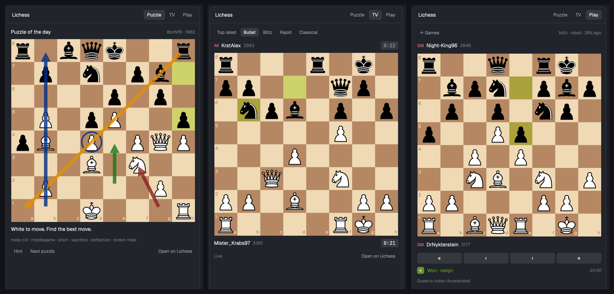

# herdr-lichess

A [Herdr](https://herdr.dev) mod: Lichess in a side panel. Solve the daily puzzle
or puzzles by theme, watch Lichess TV live, and play your own games: find an
opponent from a quick-pairing grid or play the computer, accept challenges, move by
clicking, typing or premoving, chat, answer draw and takeback offers, and step
through your recent games. Right-drag on any board to draw arrows.



## Install

Ask your agent: *"add the Herdr mod at github.com/Ghamza-Jd/herdr-lichess"*.
Or by hand:

```sh
cp -r mods/lichess ~/.config/herdr-app/mods/
herdr-app check ~/.config/herdr-app/mods/lichess
```

The first time Herdr sees the folder it docks the panel on the right, 380px wide.
To place it yourself, add a block to your layout, for example as one more child of
a panel stack:

```json
{ "id": "lichess", "type": "block", "content": { "mod": "lichess" } }
```

The live feeds (TV, your game) only run while the block is on screen: hidden
columns and inactive stack children are left alone. While you're signed in, your
account's event stream (challenges, games starting) runs either way, and your games
are checked once a minute so you hear about your move.

For a tab bar or another mod, the panel publishes `shared("lichess")` as
`{ myTurn, challenges }` (counts; `null` when signed out). For example, a dot:
`.when(Boolean(shared("lichess")?.myTurn || shared("lichess")?.challenges), el => el.child(dot))`.

To play, open **Play** and paste a Lichess API token with the *Play games with the
board API* (`board:play`) scope. The panel has a button that opens the token page.

## What's in it

- **Puzzle**: the puzzle of the day or the next one, from any of 20 themes (mate
  in 1–3, fork, pin, endgame…). Click to move; the opponent replies by itself.
  Hint, promotion picker, theme tags.
- **TV**: Top rated, Bullet, Blitz, Rapid or Classical, with live moves and clocks.
  Follows the channel to the next featured game. Flip board.
- **Play**:
  - a quick-pairing grid (10+0, 10+5, 15+10, 30+0, 30+20, 3 days), rated or casual,
    with Cancel;
  - play the computer: level 1–8, 3+2 up to 30+0 or no clock, your side;
  - incoming challenges with Accept / Decline, and games you start on the website
    show up at once;
  - your ongoing games, with a "Your turn" badge, and a toast when it becomes your
    move or someone challenges you while you look elsewhere;
  - a live board: click or type moves (`Nf3`, `O-O`, `e8=Q`, `e2e4`), premoves,
    promotion picker, chat, resign, abort, draw and takeback offers both ways, and
    claim victory when your opponent leaves;
  - your last 10 finished games with **+** / **−** / **=** and rating change; open
    one to step through it (« ‹ › », clicking a move, or ←/→ and Home/End; F flips).
- **Arrows** on every board, as on Lichess: right-drag for an arrow, right-click for
  a circle, shift = red, alt = blue, shift+alt = yellow, left-click clears.

## What it reaches

- **Network**: only `lichess.org` and its [documented API](https://lichess.org/api):
  the public endpoints (puzzles, TV feeds, game exports) and, with your token, the
  Board API.
- **Programs**: `curl` for the live feeds (a TV channel's feed, your game's Board API
  stream, your account's event stream) and pairing, which are endless HTTP streams
  that `fetch` can't read as they arrive or cancel; `sh`, `ps` and `kill` to run and
  stop them; `open` for "Open on Lichess" links. One TV or game feed runs at a time,
  only while the panel is on screen; the event stream runs while you're signed in.
- **Files**: it writes to `~/.config/herdr-app/data/lichess/`, which it makes private
  (`700`) first: the live feeds' output and `curl`'s pid (deleted when the feed
  stops; a panel that starts stops any `curl` a reloaded one left behind) and,
  while seeking or in a game, a header file with your token for `curl` (`600`,
  deleted a second after `curl` reads it). The token goes through a file because a
  command-line argument would be visible to other users in `ps`.
- **Your token** is kept in the panel's own storage, nowhere else.

Needs macOS (for `open`) and `curl`.

## Limits

- Lichess lets the Board API seek people only at Rapid, Classical and Correspondence,
  so the grid has no Bullet or Blitz. Against the computer and in challenges, Blitz
  works too; Bullet challenges open on Lichess instead.
- A search stops after 10 minutes (the longest Herdr lets a program run from a mod).
- Live updates show as soon as `curl` writes them (the mod watches the file), and at
  worst within a second.
- TV has no watcher count: the official feed doesn't carry one.
- Standard chess only (other variants' challenges open on Lichess). Puzzle attempts
  aren't sent to Lichess, so your puzzle rating doesn't change.
- Premoves promote to a queen.

## Credits

- Chess pieces: the *cburnett* set by Colin M.L. Burnett, as shipped by
  [Lichess](https://github.com/lichess-org/lila/tree/master/public/piece/cburnett),
  CC BY-SA 3.0.
- Chess rules: [chess.js](https://github.com/jhlywa/chess.js) 1.4.0 by Jeff Hlywa,
  BSD-2-Clause (vendored as `mods/lichess/chess.js`).
- Lichess is a free, open-source chess server by the Lichess team. This mod is
  unofficial and not affiliated with it.

Code: MIT. See [LICENSE](LICENSE).
