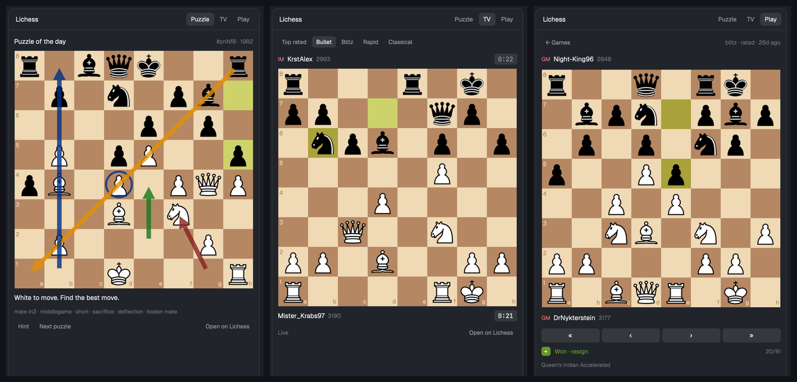

# Lichess

A side panel that brings Lichess into Herdr: the puzzle of the day, Lichess TV with
live moves, and your own games, from finding an opponent to stepping through what you
played. Boards look like Lichess's brown board, with Lichess's pieces and arrows.

## What you see

One panel (docked right, 380px), drawn as a card: `background` fill, 1px `border`,
10px radius. A 42px header with "Lichess" (semibold, 13px) on the left and three tabs
on the right: Puzzle, TV, Play (12px pills, `selected` background on the active one).
Below it, a scrolling body with 12px padding. Everything is sized to one board width:
the panel width minus 24px, between 160 and 560px, rounded down to a multiple of 8.

**The board** (shared by all tabs): squares `#f0d9b5` / `#b58863` (a1 dark); the last
move `#cdd26a` / `#aaa23a`; the selected piece `#829769` / `#646e40`; a hinted square
`#9ab8d6` / `#7a95b3`; a king in check `#f08a76` / `#d3624c`; a premove's squares
`#827b85` / `#645974`. Rank numbers on the
left file and file letters on the bottom rank, in the opposite square colour, 20% of a
square. Legal targets: a dot (28% of a square, `#14551e80`) on empty squares, a ring
on captures. Pieces are Lichess's cburnett SVGs. Arrows and circles from the user
are drawn over the pieces in `#15781bcc` green, `#882020cc` red, `#003088cc` blue or
`#e68f00cc` yellow.

**Puzzle**: "Puzzle of the day" (or "Puzzle") with `#id · rating` on the right, the
board from the side to move, a status line, theme tags (11px, `dim`), and Hint, Next
puzzle, Daily, "Theme: Mix ▾", Open on Lichess. The theme button opens a wrap of 20
pills (Mix, Mate in 1/2/3, Fork, Pin, Skewer, Discovered attack, Hanging piece,
Sacrifice, Back rank mate, Promotion, Quiet move, Defensive move, Crushing, Opening,
Middlegame, Endgame, Short, Long); picking one loads a puzzle from it, and the
header reads "Puzzle · Fork".

**TV**: channel pills (Top rated, Bullet, Blitz, Rapid, Classical), then the opponent's
bar, the board, your side's bar. A bar is the title (in `blocked` colour), name, rating
(`dim`), and on the right a monospace clock (`selected` background while it runs,
`raised` otherwise). Below: "Live", Flip board and Open on Lichess.

**Play**, signed out: a short explanation, "Create a token on lichess.org", a masked
token field and Save token.

**Play**, signed in, top to bottom:
- "Signed in as NAME", Refresh, Sign out.
- Incoming challenges, one card each (`accent` border, `selected` fill): "NAME (1850)
  challenges you", "5+3 · rated blitz · you play black", Accept and Decline. One the
  panel can't play (a variant, a set-up position, Bullet) says so and offers Open on
  Lichess instead of Accept.
- "Quick pairing" with a Rated/Casual toggle, then a 3-column grid of 62px cells
  (`raised`, 1px `border`, 8px radius): the time control at 18px and its kind under it
  (10+0, 10+5, 15+10 Rapid; 30+0, 30+20 Classical; 3 days Correspondence). While
  searching, that cell gets an `accent` border, a braille spinner and "Searching 0:12";
  the others fade to 45%; a row below says "Looking for a rapid opponent…" with Cancel.
- "Play the computer": rows labelled Level (pills 1–8), Time (3+2, 5+3, 10+0, 15+10,
  30+0, No clock) and Side (Random, White, Black, then a Play button on the right).
- Errors in `blocked`, notices in `muted`.
- "Your games": one row per ongoing game: the mod icon, "opponent (rating)", "speed ·
  you play white", and a "Your turn" (`solid`) or "Waiting" badge.
- "Recent games" with Refresh: the last 10 finished games, each with a 20px result
  badge (**+** on `#629924`, **−** on `#cc3333`, white text; **=** on `raised`),
  opponent and rating, "speed · casual · 3h ago", and the rating change in green/red.

**A live game**: "← Games" and the speed; bars and board from your side; a status line
("Your move" in `done`, "Waiting for your opponent", "Premove e2–e4. Click the board to
cancel.", "Sending move…", "Choose a piece", or the result); offer banners; when the
opponent left, "NAME left the game. You can claim victory in 12s.", then Claim victory
and Call it a draw; a move field with a Move button; then Abort (first moves only),
Resign, Offer draw, Takeback, New game (once over), Open on Lichess. Below, except
against the computer: "Chat", the last 8 lines ("name: text"; Lichess's own lines
`dim`), and a field with Send.

**A finished game**: "← Games" and "speed · rated · 3d ago"; bars and board from your
side; four step buttons « ‹ › »; the result badge with "Won · resign" and "20/91"; the
opening; every move as wrapping "1. e4 e5 2. Nf3 …" text, the current one highlighted;
"← → step · Home/End · F flips", Flip board and Open on Lichess.

**The header's Play tab** gets a 6px `accent` dot while you look at another tab and a
game waits for your move or a challenge waits for an answer.

## How it behaves

- **Moving**: click your piece, then a dot. Clicking it again, or elsewhere, deselects.
  A pawn reaching the last rank dims the board and stacks queen, knight, rook, bishop
  (grey discs) from that square toward the centre; a click elsewhere cancels.
- **Typing a move**: Enter or Move. Accepts SAN (`Nf3`, `exd5`, `O-O`, `0-0`, `e8=Q`,
  `e8q`, trailing `+#!?`) and coordinates (`e2e4`, `e7e8q`). Illegal moves and moves out
  of turn show why, in red, and send nothing.
- Your moves show at once and are sent to Lichess; if Lichess refuses, the move is
  undone and the reason shown.
- **Premoves**: while the opponent thinks, click your piece (its targets are the moves
  it would have if it were your turn), then a square. The two squares turn premove
  blue; any other click cancels. When the opponent's move arrives it's played if
  still legal, otherwise dropped. A pawn premoved to the last rank becomes a queen. A
  piece merely picked up stays picked up, with its real moves, once it's your turn.
- **Computer**: Play creates the game (`/api/challenge/ai`) and opens it.
- **Challenges** arrive on the account's event stream; Accept opens the game (it has
  the challenge's id), Decline removes the card. Games started anywhere else (the
  website, another app) appear in "Your games" at once.
- **Your move elsewhere**: while signed in and not looking at Play, your games are
  checked once a minute; a game that has just become your move gets a toast ("Lichess:
  your move", "NAME played e7e5 · blitz"), and so does a new challenge. The first check
  after starting only remembers, so you aren't told about games that were already
  waiting.
- **Opponent gone**: the Board API stream's `opponentGone` starts the countdown;
  claim when it reaches zero.
- **Chat**: the history loads with the game; lines then come from the stream, your own
  too (so they show once Lichess has them).
- **Puzzle**: a right move turns the line "Best move! Keep going." and the reply
  follows 350ms later; a wrong one says "That's not it. Try again." and isn't kept. Any
  mating move counts at the end. "Solved!" when done.
- **TV** switches to the channel's next featured game by itself. Flip board turns it
  for that channel's games until you flip back.
- **Puzzle themes**: Next puzzle uses the chosen theme (remembered); Daily ignores it.
- **Pairing**: clicking a real-time cell searches until someone accepts, then opens the
  new game. Cancel, closing the panel, a reload, quitting or signing out cancels the
  search. 3 days posts a correspondence seek and says so.
- **Offers**: "NAME offers a draw" / "NAME asks to take back a move" banners (`accent`
  border, `selected` fill) with Accept and Decline; your own pending offer shows as a
  muted line instead of its button. An accepted takeback rewinds the board.
- **Arrows**: right-drag draws (shift red, alt blue, shift+alt yellow, else green),
  right-click circles a square, repeating removes, another colour recolours, left-click
  clears. They belong to the position: in a replay they stay on their move; in a live
  game they go when a move is played.
- **Replays**: ←/↑ back, →/↓ forward, Home/End, F flips, Escape closes.
- Clocks count down every second while visible. Live feeds stop when the panel isn't
  on screen and start again (reloading the game) when it is.

## Built from

- `mods/lichess/mod.json`: `{ "place": "right", "size": 380 }`.
- `main.js`: the view. On start it stops any feed `curl` a reloaded copy left behind,
  then runs a 1-second heartbeat that decides which live feed should run
  (`tv:<channel>` or `play:<gameId>`, only while the block is visible), keeps the
  account's event stream open while signed in, loads the daily puzzle on first show,
  polls `/api/account/playing` every 20s on the Play tab (every 60s elsewhere, when you
  have games) and recent games every 2 minutes on the Play tab, reads both streams (a
  fallback), checks every 10s that their `curl`s still run (reconnecting if not), and
  redraws for running clocks and the claim countdown. It publishes
  `setShared("lichess", { myTurn, challenges })` whenever those counts change. Visibility
  walks `layout()` to the block whose `content.mod` is `lichess`: no hidden ancestor, and
  each stack's `active` is on the path.
- `game.js`: `api()` (fetch with a `User-Agent`, JSON or ndjson, form bodies), the game
  model, TV feed events, Board API stream states, clocks, typed-move parsing, premove
  targets, replays.
- `board.js`: `renderBoard()`: squares, overlays drawn with `window.paint_path` and
  `PathBuilder` polygons, right-button drag handling, the promotion picker.
- `chess.js`: chess.js 1.4.0 (ESM build, vendored) for rules and SAN.
- `pieces/`: 12 cburnett SVGs, drawn with `image()`.
- Lichess, documented API only: `/api/puzzle/daily`, `/api/puzzle/next?angle=`,
  `/api/tv/feed` and `/api/tv/{channel}/feed`, `/game/export/{id}`, `/api/account`,
  `/api/account/playing`, `/api/games/user/{name}`, `/api/stream/event`,
  `/api/board/seek`, `/api/challenge/ai`, `/api/challenge/{id}/accept|decline`,
  `/api/board/game/stream/{id}`, `/api/board/game/{id}/move/{uci}`, `…/resign`,
  `…/abort`, `…/draw/{yes|no}`, `…/takeback/{yes|no}`, `…/claim-victory`,
  `…/claim-draw`, `…/chat` (GET history, POST `room=player&text=`). A `board:play`
  token covers all of them.
- TV feed lines: `{t:"featured", d:{id, orientation, players:[{color, user, rating,
  seconds}], fen}}` when a game starts being shown, then `{t:"fen", d:{fen, lm, wc, bc}}`
  after each move (full FEN, last move, clocks in seconds).
- Board API stream lines: `gameFull` (its `state` first), then `gameState`: `moves` (all
  UCI), `wtime`/`btime` (ms), `status`, `winner`, `wdraw`/`bdraw`, `wtakeback`/`btakeback`;
  also `chatLine` (`room`, `username`, `text`) and `opponentGone` (`gone`,
  `claimWinInSeconds`).
- Event stream lines: `gameStart` / `gameFinish` (`game`: `gameId`, `color`, `isMyTurn`,
  `opponent`, `speed`, `variant`…), `challenge` (`challenge`: `id`, `url`, `challenger`,
  `timeControl`, `rated`, `speed`, `color`, `variant`, `direction`, `initialFen`; and
  `compat.board`), `challengeCanceled`, `challengeDeclined`. It opens with every
  current game and challenge.
- Herdr: `exec` (`sh`, `curl`, `ps`, `kill`, `open`), `readTextFile`, `watchFolder`,
  `fs/promises`, `appHome()`, `theme()`, `settings()`, `layout()`, `notify()`,
  `setShared()`, `localStorage`.

## Watch out

- **Lichess answers 403 without a `User-Agent`** on some endpoints (game export), and
  Herdr's `fetch` sends none. Always set one.
- `fetch` waits for the whole body and can't be cancelled, but seeks and the live feeds
  are endless HTTP streams. Seeks run in `curl` under `sh` (its pid in a file; `kill`
  cancels; `-w '\n%{http_code}'` gives the status). A feed runs in a background `curl`
  writing to `data/lichess/<tv-channel|game-id>.ndjson`; a background process outlives
  `exec`. Read it when `watchFolder(dir)` fires, keeping a byte offset and only whole
  lines, with the heartbeat as a fallback. `kill -0 <pid>` tells when `curl` has exited
  (network drop, game over). The token goes in a header file (`-H @file`): `exec` has no stdin or
  env, and an argument shows in `ps`. `fs.writeFile` can't set a mode, so make the folder
  `700` (`umask 077; mkdir -p; chmod 700`) before writing, `chmod 600` the file, and
  delete it a second after `curl` starts (it reads the file at once), plus in a `finally`.
- Exports of ongoing games lag a few moves for anti-cheating. Show the export first,
  brought up to date with `/api/account/playing`'s FEN (placement only: keep castling
  rights by hand, en passant from the last move), then let the Board API stream's full
  UCI list replace it. Rebuild only when the stream itself changed, or an older line
  rolls back the move you just played.
- The TV feed carries no watcher count and no end-of-game message; the next `featured`
  line is the switch.
- **A code reload doesn't close the old panel**, so its `curl`s run on. Each feed writes
  its pid next to its output (`<name>.ndjson.pid`); a starting panel kills each recorded
  pid that is still `curl` (`ps -p <pid> -o comm=`) before its first heartbeat.
- Lichess keeps **one event stream per token**: opening one closes the previous. Two
  copies of the panel take turns (each reconnects 5s after being closed).
- The event stream opens with every current game: don't toast those. Toasts for "your
  move" come only from polls, compared with the previous poll.
- Premove targets: load the placement with your side to move, no en passant, and
  `skipValidation` (the opponent may be in check, which a normal load refuses).
- The Board API seeks people only at Rapid, Classical and Correspondence; challenges
  and the computer also allow Blitz. A challenge's `compat.board` says whether it can be
  played here.
  `exec` caps at 10 minutes, so a search ends there.
- Never keep a `cx`; every timer, task and handler gets its own. Guard async results
  with the feed key so a stale load can't start a feed.
- gpui-kit has no occlusion: overlays don't stop clicks reaching squares, so ignore
  square clicks while the promotion picker is open.
- `positionKey` (FEN placement + side to move) keys arrows per position.

## Done when

- `herdr-app check mods/lichess` passes.
- Puzzle shows the daily puzzle; a right move gets a reply, a wrong one is refused.
- TV (Bullet) shows a live game whose board, last move and clocks change within seconds.
- With a `board:play` token: the grid finds a 10+0 game and opens it; Cancel stops a
  search; moves made by clicking and by typing reach Lichess; the opponent's moves
  arrive live; a promotion offers four pieces; draw and takeback offers show and can be
  answered.
- Recent games list +/−/= with rating changes; opening one steps through every move.
- Play the computer at level 1, 5+3: the game opens and Stockfish answers. A premove
  made while it thinks is played when its move arrives.
- A challenge sent to you from the website shows a card; Accept opens the game. Chat
  lines appear on both sides.
- Puzzle themes: picking Fork loads a fork puzzle (its tags include fork).
- Flip board turns TV and replays.
- With your move waiting and the panel hidden, a toast says so within a minute and
  `shared("lichess").myTurn` is 1.
- Right-drag draws an arrow; left-click clears it.
- Hiding the panel stops the feed's `curl` and deletes its file
  (`pgrep -fl "api/tv|board/game/stream"` finds nothing); the event stream's `curl`
  (`api/stream/event`) stays until you sign out or quit. After a code reload, no
  second TV `curl` remains.
